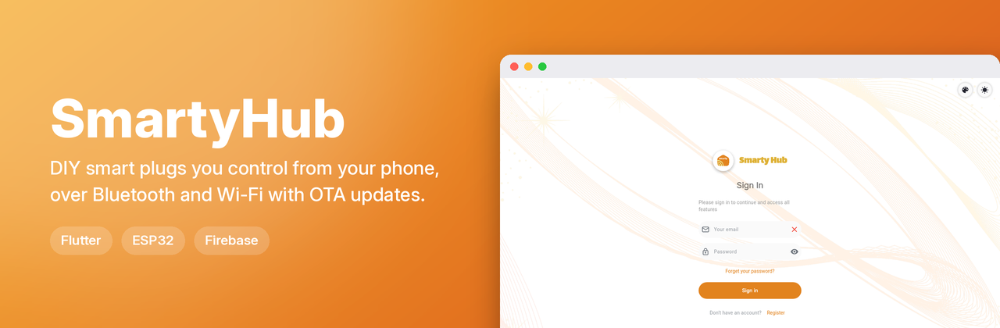
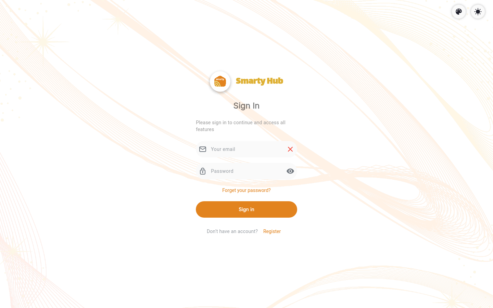
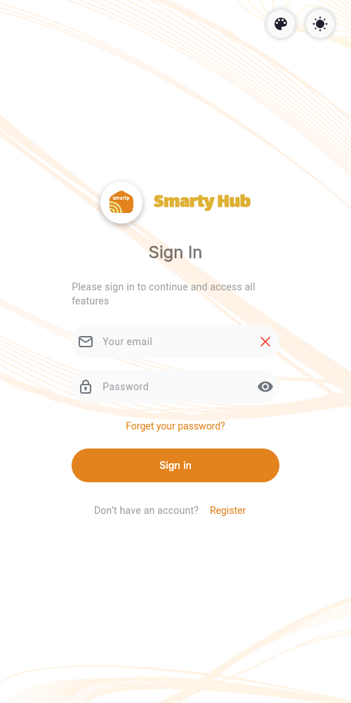

**▶ Live demo: [mohamedbenhmida-smartyhub.web.app](https://mohamedbenhmida-smartyhub.web.app)**

> The web demo shows the interface only: Bluetooth / device control needs the Android app and the hardware.

  
  

## 🏡 SmartyHub - DIY Smart Plugs Control

SmartyHub is a smart home control system that allows you to manage DIY smart plugs through a user-friendly Flutter mobile application. The app supports OTA (Over-the-Air) updates, Bluetooth, and Wi-Fi communication with ESP32 devices. It integrates with Arduino for flexible and customizable smart plug control, empowering users to easily automate and monitor their smart home appliances.

# ✨ Features
	•	Control Smart Plugs: Turn your DIY smart plugs on and off from your smartphone.
	•	OTA (Over-the-Air) Updates: Seamlessly update your ESP32 firmware directly from the app.
	•	Bluetooth (BT): Connect to smart plugs using Bluetooth for easy local control.
	•	Wi-Fi Control: Manage smart plugs over Wi-Fi, allowing remote control from anywhere.
	•	ESP32 Support: Built on the powerful ESP32 microcontroller for efficient and reliable operation.
	•	Arduino Compatibility: Customizable code for Arduino-based DIY projects.
	•	Multiple Devices: Manage multiple smart plugs and devices in a single app.
	•	Device Management: Add, remove, and configure your devices and rooms.
	•	Encryption: Secure communication between the app and smart plugs.
 
# 🛠️ How to Run
	1.	Clone the Repository:

git clone https://github.com/mohamedbnhmida/SmartyHub .git  
cd smartyhub  

	2.	Install Dependencies:

flutter pub get  

	3.	Setup the Arduino Firmware:
	•	Go to the arduino/ folder and open the smart_plug_firmware.ino file in Arduino IDE.
	•	Select the ESP32 board and upload the firmware to your ESP32 device.
	4.	Run the App:

flutter run  

🔧 Setup ESP32 & Arduino
	1.	Install the ESP32 Board in Arduino IDE:
	•	Go to File > Preferences and add the following URL to the Additional Board Manager URLs:

https://dl.espressif.com/dl/package_esp32_index.json  

	•	Then, go to Tools > Board > Boards Manager, search for ESP32, and install the board package.

	2.	Upload the Firmware to ESP32:
	•	Open the smart_plug_firmware.ino file in Arduino IDE.
	•	Select ESP32 Dev Module under Tools > Board.
	•	Upload the firmware to your ESP32 device via USB.

 
# 🧑‍💻 Technologies
	•	Flutter: Frontend framework for building mobile applications.
	•	Dart: Programming language for Flutter.
	•	ESP32: Microcontroller for smart plug management.
	•	Arduino IDE: Development environment for writing and uploading code to the ESP32.
	•	GetX: State management solution for Flutter.
	•	OTA Updates: Over-the-air updates for the ESP32 device firmware.
	•	Bluetooth (BT): Communication protocol for local control of devices.
	•	Wi-Fi: Communication protocol for remote control of devices.

# 🌟 Customization
	•	Smart Plug Control: Customize the control functions in the controllers/smart_plug_controller.dart file.
	•	OTA Updates: Modify the ota/ota_update.dart file to adjust how the firmware update process works.
	•	UI Components: The app’s user interface is modular and easy to customize. Change colors, themes, and layouts via the utils/themes.dart file.

📜 License

This project is licensed under the MIT License. You are free to use, modify, and distribute this template in your projects.

🚀 About

SmartyHub is a comprehensive, flexible solution for controlling smart plugs in a DIY home automation system. With support for Bluetooth, Wi-Fi, OTA updates, and Arduino, it’s a perfect project for both hobbyists and developers looking to build custom smart home solutions. Contributions and feedback are welcome!
 